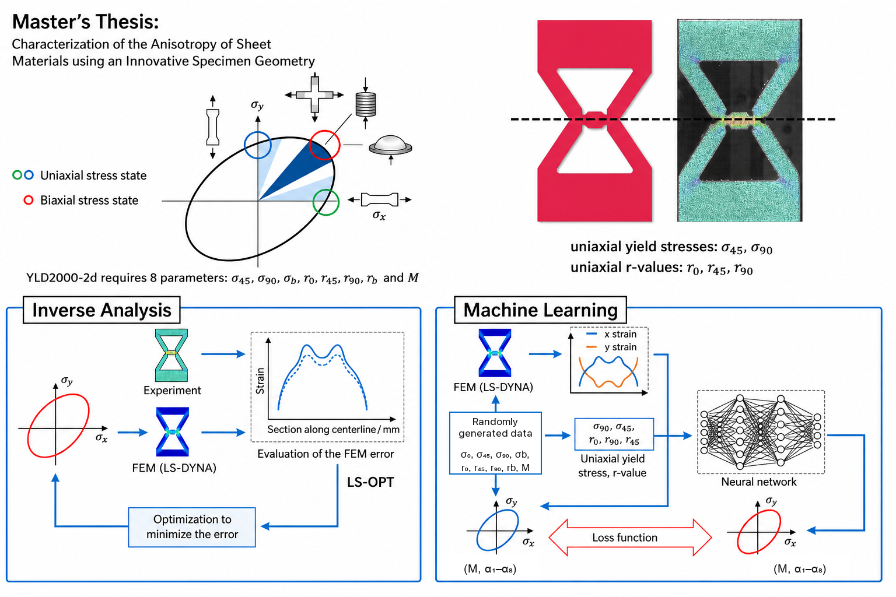

# Material_Model — LS-DYNA Material Model Calibration

Research code for the master’s thesis **“Characterization of the Anisotropy of Sheet Materials using an Innovative Specimen Geometry.”** The project combines **experimental strain data**, **LS-DYNA finite-element simulations**, **YLD2000-2d anisotropic yield modeling**, **inverse analysis**, and **neural-network-assisted parameter inference**.

<p align="center">
  
</p>

<p align="center"><sub>From biaxial specimen design and full-field strain measurements to YLD2000-2d parameter identification.</sub></p>

The central goal is to identify anisotropic sheet-material behavior from the response of an innovative biaxial specimen. The work compares two complementary strategies:

- **Inverse analysis:** iteratively adjust the material model so that FEM results reproduce the experimental strain response.
- **Machine learning:** generate a simulation database from randomized material parameters, learn the relationship between strain responses and material parameters, and infer YLD2000-2d parameters from experimental data.

## Research Background

The YLD2000-2d formulation is used to describe planar anisotropy of sheet materials. In the thesis workflow, the material description is based on the parameter set

`σ45, σ90, σb, r0, r45, r90, rb, M`

which combines directional yield stresses, r-values, the biaxial response, and the exponent `M`.

The innovative specimen geometry is designed to generate different stress states within one test, including regions that approach uniaxial and biaxial loading. This makes spatial strain distributions particularly useful for parameter identification.

## Methodology

### 1. Inverse Analysis

The inverse-analysis route follows the loop

```text
Experiment
   ↓
FEM simulation (LS-DYNA)
   ↓
Compare strain response
   ↓
Evaluate error
   ↓
LS-OPT parameter optimization
   ↓
Updated YLD2000-2d parameters
   ↺
```

The optimization objective is to minimize the discrepancy between experimental and simulated response quantities.

### 2. Machine-Learning-Assisted Calibration

The data-driven route follows

```text
Random YLD2000-2d parameter sets
   ↓
LS-DYNA simulations
   ↓
Extract x/y strain responses
   ↓
Build training dataset
   ↓
Neural network
   ↓
Infer material parameters from experiment
```

This workflow reduces repeated iterative optimization during parameter identification by learning an inverse mapping from simulated response data to material-model parameters.

## Workflow Implementation

A typical dataset-generation and inference workflow is organized as the following stages:

| Stage | Script | Purpose |
| --- | --- | --- |
| P1 | `make_dataset/scripts/P1_cre_para_csv_3.py` | Generate material-property samples and identify corresponding YLD2000-2d parameters. |
| P2 | `make_dataset/scripts/P2_cre_key_files.py` | Create LS-DYNA keyword files for the generated parameter sets. |
| P3 | `make_dataset/scripts/P3_cre_outp_standardization*.py` | Standardize material parameters used as dataset outputs. |
| P4 | `make_dataset/scripts/P4_dyna_lsprepost_run.py` | Run LS-DYNA analyses and LS-PrePost post-processing in batch. |
| P5 | `make_dataset/scripts/P5_cre_inp_10.py` | Extract and assemble simulation results into model inputs. |
| P6 | `make_dataset/scripts/P6_*.py` | Evaluate yield-function / parameter errors and related quantities. |
| P7 | `make_dataset/scripts/P7_edit_ex_modify_data3.py` | Convert experimental data into the format required by the inference workflow. |
| P8 | `make_dataset/scripts/P8_nnabla_run2.py` | Run NNabla CLI forward inference and collect inferred parameters. |

`make_dataset/main_before_CNN.py` contains an example orchestration of several of these stages and shows how the LS-DYNA and LS-PrePost executable paths are configured.

## Project Structure

```text
.
├── README.md
├── LICENSE
├── assets/
│   └── material_model_workflow.png  # Thesis overview and calibration workflows
├── tensile_test.py                  # Experimental tensile-test data processing
├── FEM_model_modify.py              # FEM result extraction and model/post-file processing
├── fit_tri.ipynb                    # Notebook for exploratory fitting / analysis
│
├── experiment_data/                 # Experimental datasets
├── analysis/                        # Analysis scripts
│
├── make_dataset/
│   ├── main_before_CNN.py           # Example dataset/simulation orchestration
│   └── scripts/                     # P1–P8 dataset-generation and inference workflow
│
├── ML/
│   └── nnc/
│       └── EX2NN.py                 # Experimental/simulation strain preprocessing for NNC input
│
├── yld2000/                         # YLD2000-2d parameter calculation and visualization
├── YLD_2d_Investigation/            # Additional YLD2000-2d investigations and yield-curve tools
└── utils/                           # Helper scripts and utilities
```

## Requirements

### External Software

Some workflows require software that is not included in this repository:

- **LS-DYNA** — finite-element solver.
- **LS-PrePost** — LS-DYNA post-processing.
- **LS-OPT** — optimization environment used for the inverse-analysis route.
- **NNabla CLI / Neural Network Console** — required for the P8 inference workflow.

### Python

The scripts are written for Python 3 and use packages including:

```text
numpy
pandas
matplotlib
scipy
sympy
tqdm
```

Jupyter is useful for working with `fit_tri.ipynb`.

> **Note:** the repository currently does not contain a pinned `requirements.txt`. Install the packages required by the scripts you plan to run.

## Setup

Clone the repository and create a virtual environment:

```bash
git clone https://github.com/Kevoyuan/Material_Model.git
cd Material_Model

python -m venv .venv
```

Activate the environment:

```bash
# Windows
.\.venv\Scripts\activate

# Linux / macOS
source .venv/bin/activate
```

Install the main Python dependencies:

```bash
pip install numpy pandas matplotlib scipy sympy tqdm jupyter
```

## Usage

This repository contains research scripts rather than a packaged command-line application. Before running the simulation, optimization, or inference workflows, review the machine-specific file paths and solver settings inside the relevant scripts.

### Experimental Data Processing

`tensile_test.py` contains utilities for reading tensile-test CSV data, calibrating specimen coordinates, processing strain distributions, and visualizing results.

```bash
python tensile_test.py
```

### FEM Processing

`FEM_model_modify.py` combines FEM result extraction, strain calculations, YLD2000-2d utilities, and post-processing helpers. It is intended to be used together with the supporting analysis/helper modules and generated LS-DYNA result folders.

### Dataset Generation

The main dataset workflow lives in `make_dataset/scripts/`. The P1–P8 scripts are designed as sequential research-processing stages rather than independent generic CLI tools.

`make_dataset/main_before_CNN.py` demonstrates the simulation-stage configuration, including CPU count, LS-DYNA solver location, LS-PrePost location, and post-processing command files.

### NNabla Inference

`make_dataset/scripts/P8_nnabla_run2.py` invokes

```text
nnabla_cli forward
```

to run trained `.nnp` models on prepared experimental input data and collect the inferred material parameters.

`ML/nnc/EX2NN.py` is a preprocessing helper that reduces simulation strain data and updates CSV paths used by the Neural Network Console workflow; it is not itself a neural-network training script.

## Configuration Notes

Several scripts were developed for a specific Windows research environment and therefore contain machine-specific paths such as LS-DYNA executables, LS-PrePost executables, `.nnp` files, CSV datasets, and output directories.

Before reproducing a workflow on another machine, check and update these paths, especially in:

- `make_dataset/main_before_CNN.py`
- `make_dataset/scripts/P4_dyna_lsprepost_run.py`
- `make_dataset/scripts/P8_nnabla_run2.py`
- `ML/nnc/EX2NN.py`

For reproducible studies, keep solver versions, material-model settings, parameter ranges, preprocessing choices, and generated datasets documented together.

## Key Components

### YLD2000-2d

The `yld2000/` package contains tools for YLD2000-2d parameter calculation and yield-surface visualization, including:

- `YLD2000_2d_realM_EN.py`
- `Draw_YieldFunction_M_for_real.py`
- `plot_mult_yld.py`

### Experimental Data Processing

The repository includes workflows for processing tensile/biaxial-test data, strain distributions, specimen-coordinate calibration, and comparison between experiments and FEM results.

### Simulation-to-ML Pipeline

The `make_dataset/` workflow links material parameters to LS-DYNA simulation results and prepares the resulting strain/response data for data-driven material calibration.

## Thesis Context

This repository was developed for the master’s thesis:

**Characterization of the Anisotropy of Sheet Materials using an Innovative Specimen Geometry**

The supplied thesis overview summarizes the two main approaches used in the work—**Inverse Analysis** and **Machine Learning**—and highlights the role of LS-DYNA, LS-OPT, strain-field evaluation, and YLD2000-2d parameter identification.


## Contributing

Contributions, bug reports, and improvements are welcome. For larger changes, please open an issue or pull request describing the proposed modification and the workflow it affects.

## License

This project is licensed under the [MIT License](LICENSE).
